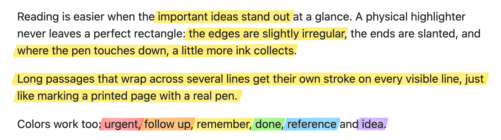
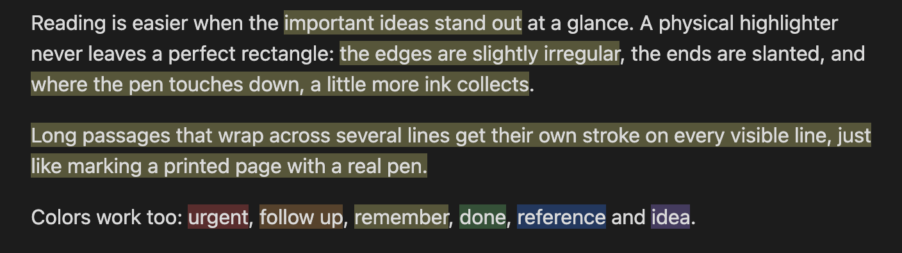
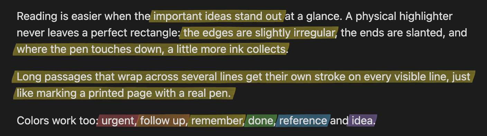

# Real Highlights

Turn your Obsidian `==highlights==` into realistic highlighter pen strokes – with organic edges, slanted chisel tips, ink texture and a little extra ink where the pen touches down.

| Obsidian default | Real Highlights |
| --- | --- |
|  |  |
|  |  |

**[Try it live in your browser →](https://danielgottbehuet.github.io/obsidian-real-highlights/)**

## Features

- **Works with the highlights you already have.** Uses Obsidian's native `==highlight==` syntax. Your notes are never changed – disable the plugin and you get the regular highlights back.
- **Looks like a real pen.** Slightly irregular edges, slanted ends from the chisel tip, subtle fiber texture, ink pooling at the start and end, a small overshoot past the text.
- **Every highlight is unique – and stays the same.** Strokes are generated procedurally from the highlighted text, so each one looks a little different, but the same highlight always looks identical when you reopen the note. No images are stored.
- **One stroke per line.** Highlights that wrap across several lines get a separate stroke on every visible line, and adapt when you resize the window.
- **Highlight colors.** Supports Obsidian's colored highlights (`==🔴text==`, `==🟠text==`, `==🟡text==`, `==🟢text==`, `==🔵text==`, `==🟣text==`) with a highlighter-style pen color for each.
- **Reading view and Live Preview.** Strokes are drawn behind the text; cursor, selection and line heights are untouched. Source mode stays unchanged.
- **Light and dark mode.** Ink-like blending on light themes, readable strokes on dark themes.
- **Five presets:** Classic, Pastel, Dry Marker, Quick Stroke and Heavy Ink.
- **English and German** interface, following Obsidian's language.

## Usage

Highlight text the way you always do:

```markdown
This is ==important==.
This is ==🔵a blue highlight==.
```

Commands (assign hotkeys under *Settings → Hotkeys*):

- **Toggle highlight** – adds or removes `==` around the selection. Also available in the editor context menu.
- **Toggle realistic highlights** – switches between realistic strokes and Obsidian's default highlights.

## Settings

- Reading view / Live Preview on or off
- Preset
- Default color, plus one pen color for each highlight color
- Opacity, stroke height, edge roughness, fiber texture and ink intensity
- Blend mode for light mode; blend mode and opacity for dark mode

The settings page includes a live preview.

## Installation

**From Community plugins** (once available): *Settings → Community plugins → Browse*, search for “Real Highlights”, install and enable.

**Manually:** download `main.js`, `manifest.json` and `styles.css` from the [latest release](https://github.com/danielgottbehuet/obsidian-real-highlights/releases/latest), put them into `<your vault>/.obsidian/plugins/real-highlights/`, then enable *Real Highlights* under *Settings → Community plugins*.

## Compatibility

- Requires Obsidian **1.8.7** or newer.
- Tested on desktop (macOS) with Obsidian 1.13.7 and 1.15.1. Mobile has not been tested yet.
- Colored highlights need an Obsidian version that supports them (1.15.1 does, 1.13.7 doesn't). With older versions the color emoji is still detected, but stays visible in Live Preview.

## Known limitations

- Live Preview relies on how Obsidian marks highlights in the editor. If a future Obsidian version changes that, you'll simply see the default highlights until the plugin is updated.
- Text that looks different in Reading view and Live Preview (for example links with an alias) can get a slightly different stroke in each view.
- Inline code inside a highlight keeps its own background on top of the stroke.

## How it works

Each stroke is an SVG generated by a small, deterministic rendering engine: seeded noise for the edges and the slight up-and-down movement of the pen, a pressure model for ink intensity, procedural fibers and paper grain. The seed comes from the highlighted text, the geometry from its actual rendered size. Developer documentation (in German) is in [docs/development.md](docs/development.md).

## Support

If Real Highlights makes your notes a little nicer, you can support its development:

<a href="https://buymeacoffee.com/derscottbert"></a>

## License

[MIT](LICENSE) © Daniel Gottbehüt
